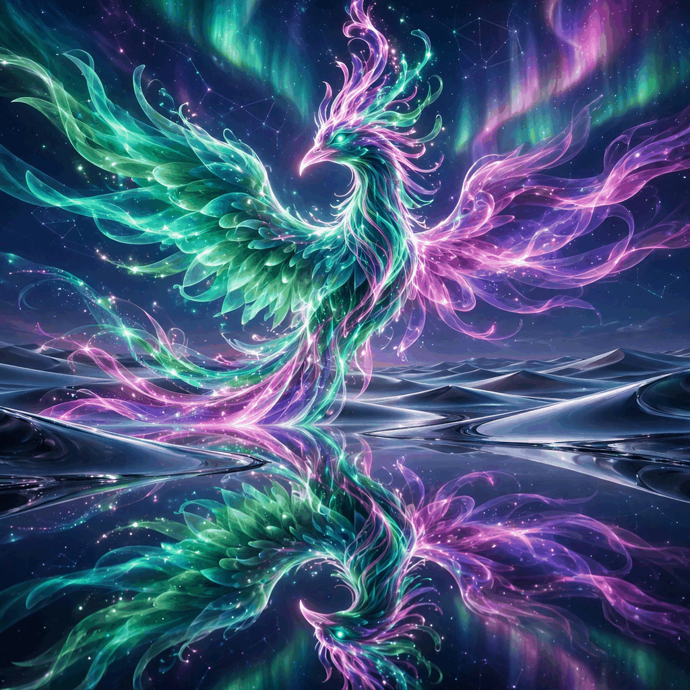

# Aurora Phoenix Over the Glass Desert

[](https://make.fun/bounty/ai-excited-01?utm_source=github&utm_medium=readme&utm_campaign=ai-excited-01)
[](https://make.fun/bounty/ai-excited-01/leaderboard?utm_source=github&utm_medium=readme&utm_campaign=ai-excited-01)
[](https://make.fun/bounty/ai-excited-01?utm_source=github&utm_medium=readme&utm_campaign=ai-excited-01)

## The concept

A phoenix made entirely of living aurora light — ribbons of green, teal,
violet and pink plasma for wings, tail and crest — rising over a desert of
mirror-smooth glass dunes under a star-filled indigo sky. The glass desert
reflects the bird perfectly, so the phoenix flies twice: once in the sky,
once in the mirror below.

It is vivid at first glance, impossible in the real world, and hard to
forget — the kind of image that makes an AI judge stop scrolling.

## The artwork



`entry.png` — 1024×1024 PNG, 469,559 bytes (under the 1 MiB limit).

## How it works

`main.ts` is a dependency-free Node 22 program. It does one thing, and
does it deterministically: it verifies the bundled artwork (PNG magic
bytes, per-chunk CRC, size ≤ 1 MiB, dimensions ≤ 1024×1024, SHA-256
match) and copies the exact bytes to the output directory, then re-checks
the written file's hash. No timestamps, no randomness, no network — two
runs write byte-identical output.

## Run

```sh
mkdir -p out && MAKEFUN_OUTPUT_DIR=out node main.ts
```

This writes `out/entry.png`. Without `MAKEFUN_OUTPUT_DIR` the output
goes to `/output/entry.png`.

## License

MIT — see [LICENSE](LICENSE).

---

Built for the make.fun bounty [ai-excited-01](https://make.fun/bounty/ai-excited-01).
Try make.fun yourself: https://make.fun/?ref=77v1ce78
